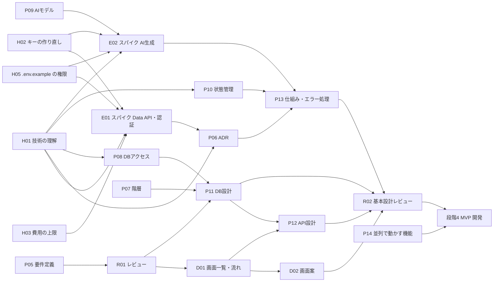

# 計画（段階とタスクの順番）

- 作成：2026-11-25（TASK-P04）。2026-11-25 更新：TASK-P04 のレビュー指摘を反映し、H05・H06 を追加。認証ライブラリを Better Auth に変えたことに合わせて E01 を更新（TASK-P16）
- v1 のロードマップ（Layer 1〜4：インフラ・可観測性・負荷テストを段階的に足す計画）は使わず、このファイルに置き換えた（引き継ぎ事項 A5）
- **工数と日程は見積もらない**（作者の判断・2026-11-25）。目標は 2027年1月上旬に MVP を公開すること（引き継ぎ事項 A3）。このファイルでは段階と、タスクの順番・依存関係だけを決める
- タスクの状態（ステータス・理解済みかどうか）はタスク一覧で管理する。このファイルには段階と順番を書く。終わったタスクは表から消す

## 1. 全体の段階

| 段階 | やること | 終わりの目印 |
|---|---|---|
| 1. 準備（済） | 運用ルール、リポジトリ、引き継ぎ事項、計画、工程ごとの資料のルール | P01〜P04・P15・E03 完了 |
| 2. 設計の前提をそろえる | 技術構成の理解、要件定義、未決事項の判断、スパイク | H01〜H03・H05・P05・R01・P06〜P10・E01・E02 完了 |
| 3. 基本設計 | 画面、DB、API、処理の仕組み | D01・D02・P11〜P13 と R02（基本設計のレビュー）完了 |
| 4. MVP 開発 | 土台 → 機能 → 公開前の対策 → リリース。始める前に P14 を決める | v0.1.0 を main に出す |
| 5. Phase2 | 2月以降の機能 | — |

段階2と3は重なってよい。依存タスクが終わったものから始める。

## 2. 段階2・3のタスクと依存関係

「解説」は、作者が理解してから進めるタスクかどうか（要＝解説 → 質問 → 3行まとめを済ませてから判断・実装に進む）。

| タスク | 内容 | 依存タスク | 解説 |
|---|---|---|---|
| H01 | 技術構成を理解する（Next.js → 認証 → Amplify Hosting → Aurora Serverless v2・Data API） | — | 要 |
| P05 | 要件定義を作り直す | — | 不要 |
| R01 | 要件定義のレビュー | P05 | 不要 |
| P07 | データモデルの階層を決める（4階層か3階層か） | — | 要 |
| P09 | AI モデルを今の世代で決め直し、費用を見積もり直す | — | 要 |
| H02 | 旧環境の API キー・OAuth シークレットを作り直す | —（E01・E02 の前） | 要 |
| H03 | 費用の上限を設定する | —（E01 の前） | 要 |
| H05 | Claude Code が .env.example を編集できるように settings.json の禁止を見直す | —（E01・E02 の前） | 不要 |
| E01 | スパイク：Amplify から Data API を呼べるか、Next.js 16 の対応、Better Auth（JWT 方式）で Google ログインが動くか | H01、H02、H03、H05 | 要 |
| E02 | スパイク：AI 問題生成にかかる時間を測り、同期か非同期ジョブかを決める | H01、H02、H05、P09 | 要 |
| P06 | 技術構成の ADR を作り直す | H01、E01 | 不要 |
| P08 | DB アクセスの方法を決める（ORM か SQL を直接書くか） | H01 | 要 |
| P10 | 画面の状態管理が必要か決める | H01 | 要 |
| D01 | 画面一覧と画面の流れを作る | R01 | 不要 |
| D02 | 主要画面の画面案を作る | D01 | 不要 |
| P11 | DB 設計（テーブル定義と ER 図） | R01、P07、P08 | 要 |
| P12 | API 設計（画面ごとの処理と、Route Handlers・Server Actions の一覧） | D01、P11 | 要 |
| P13 | 処理の仕組みとエラー処理の方針（AI 生成の流れ、DB の再開待ち、ゲストモード、回数制限、ログ、テスト） | P06、P10、E02 | 要 |
| R02 | 基本設計のレビュー | D02、P11、P12、P13 | 不要 |
| P14 | 実装を並列で進める Claude Code の機能（Agent Teams など）を使うか決める | —（段階4のタスクを出す前） | 要 |

### 進める順番の目安

- **最初に始めるもの**：H01（技術の理解）と P05（要件定義）。この2つから先のタスクがほとんど枝分かれする
- H02・H03・H05 は、それを使うスパイク（E01・E02）の前に済ませる

## 3. 段階4：MVP 開発（基本設計が終わったらタスクにする）

作る順番は次のとおり。タスクへの分け方は、R02 が終わったあとに決める（P14 の結果も踏まえる）。

機能ごとに **詳細設計 → 実装と単体テスト → 結合テスト** の順で進め、工程ごとに資料を残す。資料の置き場所は運用ルール（rules.md の「7.」）に従う。

1. 土台：プロジェクトのひな形、ローカルの DB、CI（ブランチ保護に必須チェックを足す）→ Google ログイン → 1画面 → API → Data API 経由で DB → Amplify にデプロイ
2. 資格ごとの階層 Todo（資格＞章＞タスクなど。階層の数は P07 で決める）、試験日カウントダウン、1日のノルマ計算
3. Markdown メモ
4. AI 問題生成と、解答・採点（question_answers テーブル）
5. 進捗ダッシュボードと学習カレンダー（何日にどのくらい学習したかを、GitHub の草のようなマス目で表示する）
6. 公開前の対策：ゲストモード、AI 生成の回数制限
7. リリース：develop → main、`v0.1.0`

学習カレンダーは、もとは 2月以降の機能だったが、2026-11-25 に MVP に入れた（作者の判断）。何を「学習した量」として数えるか（解いた問題数、完了したタスク数、メモの編集など）は要件定義（P05）で決める。

AWS のリソースを初めて作るのは 1. の土台（E01 のスパイクを除く）。その前に H03 を済ませる。

## 4. 段階5：Phase2

- 2月以降：AI 要約（＋サンプルコード生成）、弱点シャッフル
- 後回し：解説チャット、合格可能性判定、資格テンプレート、集中時間トラッカー、テスト結果の手動記録
